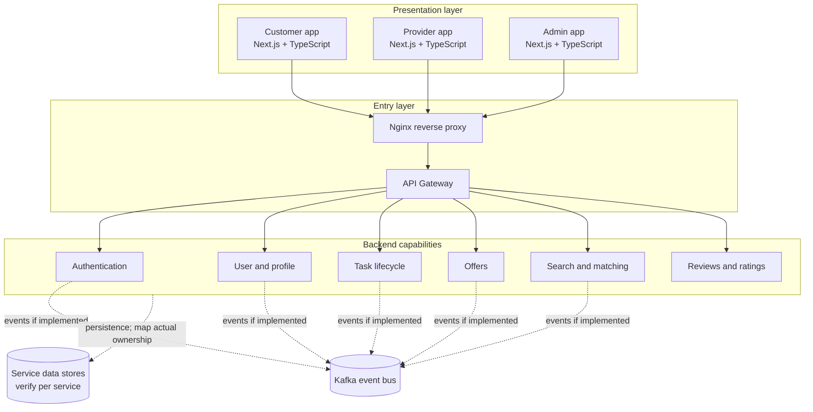

# Architecture Overview

## 1. Architectural intent

Taskino is organized as a monorepo containing three web applications, backend business services, shared packages, and infrastructure configuration. The service boundaries are intended to separate business capabilities while allowing the codebase to be developed and reviewed in one repository.

This document describes the intended logical architecture based on the known directory layout. Confirm every runtime connection against the gateway configuration, Docker Compose, service code, and environment settings before treating the diagram as a deployment topology.

## 2. System context

The database node is intentionally abstract. Replace it with named stores and explicit ownership once verified. Dotted event lines indicate potential/implemented-where-present integrations, not proof that every service publishes events.

## 3. Logical layers

### Presentation layer

- `Frontend/app/u-app`: customer-facing application.
- `Frontend/app/t-app`: service-provider application.
- `Frontend/app/admin-app`: administration application.

All three are described as Next.js, TypeScript, and Tailwind CSS applications. Verify actual app-router structure, authentication integration, and build scripts.

### Entry layer

- Nginx is configured under `infra/nginx`.
- The API Gateway is a backend component intended to route incoming API requests and handle gateway-level concerns such as token validation where implemented.

Document which component terminates TLS, which paths it forwards, and whether clients can bypass the gateway in the local and deployed environments.

### Business services

| Service | Intended responsibility |
|---|---|
| Auth | OTP-based authentication, sessions, refresh tokens, MFA, and related security workflows |
| User | Profiles, provider skills, and verification-related data |
| Task | Task/order creation, validation, and lifecycle transitions |
| Offer | Provider offers and offer lifecycle |
| SearchService | Search and matching functionality |
| ReviewRating | Reviews and ratings |

These are responsibility boundaries, not a claim that every workflow is complete.

### Shared packages

- `Share/EventBus`: event contracts and related shared definitions.
- `Share/packages/api-client`: reusable HTTP client.
- `Share/packages/auth-sdk`: authentication integration helpers.
- `Share/packages/auth-store`: shared authentication state, described as using Zustand in project notes.
- `Share/packages/types`: shared TypeScript types.
- `Share/packages/ui-kit`: reusable UI components.

Shared packages are build-time code dependencies; they are not automatically independent runtime services.

## 4. Communication styles

Document the actual use of each style:

- **Synchronous HTTP:** request/response operations through the gateway and service APIs.
- **Asynchronous events:** Kafka producer/consumer relationships where implemented.
- **Real-time messaging:** Socket.IO has been used or planned in the chat component; document its current status separately.
- **Persistence:** identify each service's actual database and whether any stores are shared.

Do not assume that every service communicates through Kafka or that Kafka replaces synchronous APIs.

## 5. Data ownership

A service should have a clearly documented owner for each business entity. Before claiming database-per-service, verify:

1. Which database/schema each service uses.
2. Whether services access another service's tables directly.
3. Whether migrations are isolated.
4. How cross-service data is synchronized.
5. How eventual consistency is handled.

Project notes mention PostgreSQL/Prisma and MongoDB in different components. Create a verified service-to-database map from the actual configuration.

## 6. Reliability topics to document

For every asynchronous flow, record:

- Event name and schema version.
- Producer and consumer.
- Delivery assumptions and duplicate handling.
- Retry policy and dead-letter handling, if present.
- Consumer offset/acknowledgment strategy.
- Correlation/trace identifiers.
- Recovery and replay procedure.
- Transaction boundary and consistency guarantees.

For every synchronous flow, record timeouts, error mapping, authentication propagation, and dependency-failure behavior.

## 7. Scaling and deployment

Do not infer production scalability from microservice boundaries alone. Document the deployment topology, replicas, resource limits, load balancing, database sizing, Kafka partitions, observability, and recovery mechanisms only when they exist or have been explicitly designed.

## Related diagrams

- [System context](diagrams/system-context.mmd)
- [Task lifecycle](diagrams/task-lifecycle.mmd)
- [Task sequence](diagrams/task-sequence.mmd)
- [Authentication sequence](diagrams/authentication-sequence.mmd)
- [Kafka event flow](diagrams/kafka-event-flow.mmd)
