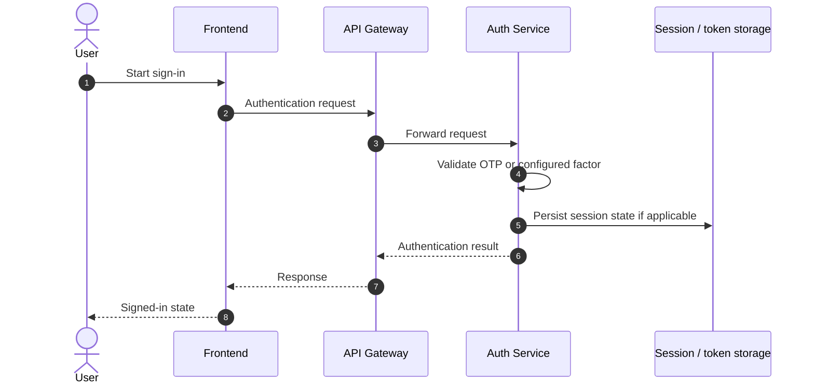

# Authentication and Session Flow

## Scope

Taskino's authentication component has been described as supporting OTP, refresh tokens, sessions/trusted devices, and basic MFA. Verify which of these flows are active in the current code and document each separately.

## Conceptual sequence

This is a conceptual diagram. Replace it with separate diagrams for OTP initiation, OTP verification, refresh, logout, MFA, and trusted-device flows if they exist.

## Security questions to answer

- How are OTP values generated, stored, expired, and rate-limited?
- Are OTP values stored hashed or in plaintext?
- How are access and refresh tokens signed and validated?
- Which issuer, audience, expiry, and algorithm checks are enforced?
- Where are tokens stored in the browser: cookies, memory, or another mechanism?
- How does refresh-token rotation work?
- How are token reuse and revoked sessions handled?
- How is logout propagated across devices?
- How are MFA secrets protected?
- How are trusted devices identified and revoked?
- What data is logged, and what must never appear in logs?

Do not publish token values, private keys, MFA secrets, OTPs, or live user data in examples.
