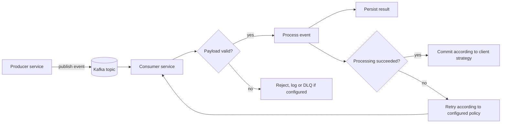

# Kafka Event Flow

## Purpose

Kafka can decouple services when one business action must trigger work in other services without requiring every downstream operation to finish within the original HTTP request. Document only producer/consumer integrations that are present in code.

## Conceptual event flow

## Event catalog

Create a table for every actual topic:

| Topic | Producer | Consumer group | Event schema | Purpose |
|---|---|---|---|---|
| Verify in code | Verify in code | Verify in code | Link to schema | Verify in code |

Do not infer topic names from event names. Record the exact configured names and schema versions.

## Event contract checklist

Each event definition should specify:
- Event name and schema version.
- Event ID and occurrence timestamp.
- Aggregate/entity ID.
- Correlation ID and causation ID, if used.
- Producer and consumer ownership.
- Required and optional payload fields.
- Compatibility strategy for schema changes.
- Partition key and ordering expectations.
- Retry, duplicate, and poison-message behavior.
- Consumer offset/acknowledgment semantics.

## Reliability considerations

- **At-least-once delivery:** if the configured consumer may receive duplicates, handlers should be safe to retry.
- **Idempotency:** define how a duplicate event is detected and prevented from repeating side effects.
- **Outbox pattern:** consider it if a database update and event publication must not diverge; do not claim it is implemented without code evidence.
- **Retries and dead-letter queues:** document actual retry limits, backoff, and recovery process.
- **Ordering:** Kafka ordering is partition-scoped; document the partition key and business assumptions.
- **Observability:** include event IDs and correlation IDs in structured logs without exposing secrets.

## Local verification

Record the actual Docker Compose service names, bootstrap addresses as seen from host vs containers, topic creation strategy, and commands used to inspect consumer groups and messages. Never assume `localhost` is the correct broker address from inside a container.
