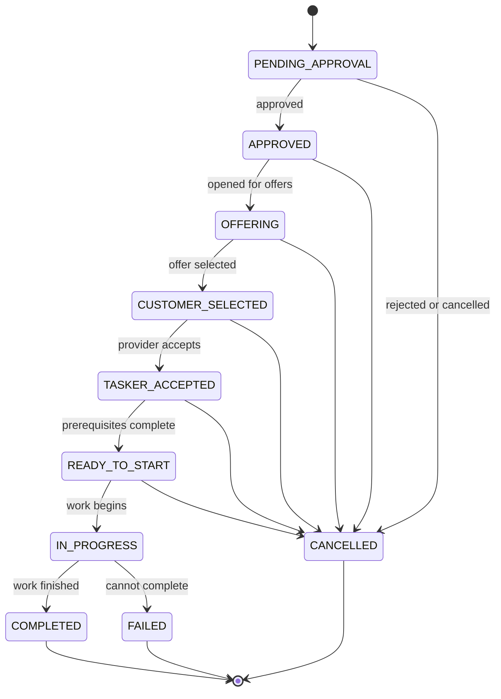

# Task Lifecycle

## Purpose

This document describes the intended task workflow and the state names previously discussed for Taskino. The state machine must be compared with the current Task Service implementation before it is considered authoritative.

## Proposed lifecycle

## Candidate states

| State | Intended meaning | Verify |
|---|---|---|
| `PENDING_APPROVAL` | Submitted and awaiting moderation | Who can approve/reject? |
| `APPROVED` | Approved for the next workflow step | Is this state stored? |
| `OFFERING` | Providers can respond with offers | When does it open/close? |
| `CUSTOMER_SELECTED` | Customer selected an offer | Is provider acceptance still required? |
| `TASKER_ACCEPTED` | Provider accepted the selected work | Timeout and cancellation rules |
| `READY_TO_START` | Preconditions for starting are met | Which preconditions? |
| `IN_PROGRESS` | Work has started | Who may transition into this state? |
| `COMPLETED` | Work marked complete | Does payment happen before or after this state? |
| `CANCELLED` | Task cancelled | Allowed actors and cancellation reasons |
| `FAILED` | Task could not be completed | Retry, dispute, and recovery behavior |

## State transition rules to document

For each transition, record:
1. Allowed source and destination states.
2. Authorized actor and required permission.
3. Validation conditions.
4. Database transaction boundary.
5. Events emitted after commit, if any.
6. Idempotency and duplicate-request behavior.
7. Side effects such as offer expiration, notifications, chat, or payment.
8. Recovery behavior when downstream services are unavailable.

## Important design questions

- Are state transitions enforced centrally in the Task Service?
- Can clients submit arbitrary status values, or do they call dedicated actions?
- How are concurrent updates prevented from overwriting each other?
- Are events published after the database transaction commits?
- What happens if persistence succeeds but event publication fails?
- Is a completed task reversible, and who can reopen a dispute?
- Is payment triggered by task completion, or does completion depend on payment?

Answer these from the current code; do not assume a particular answer.
